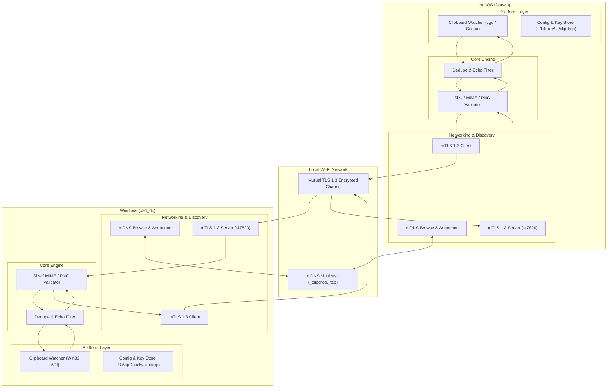
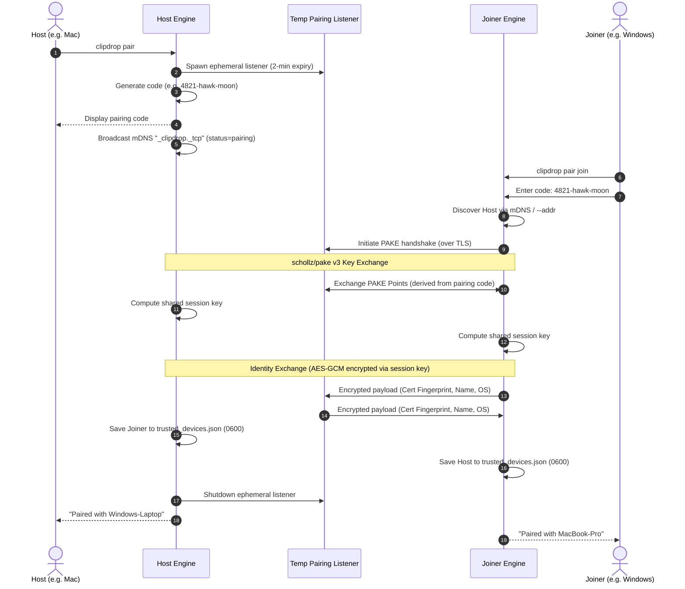
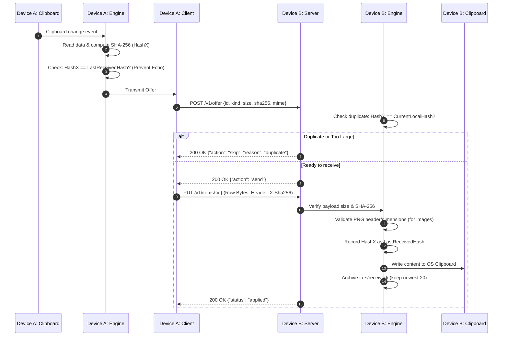
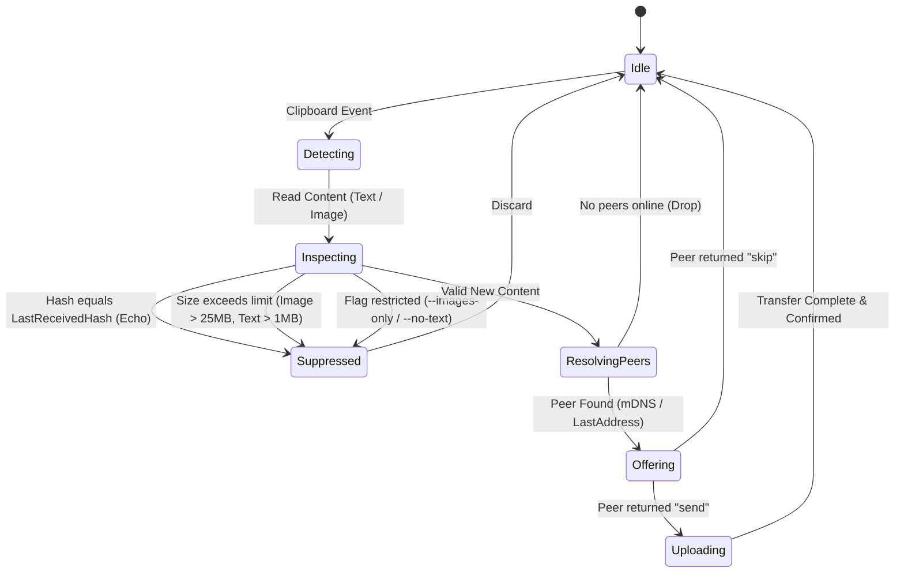
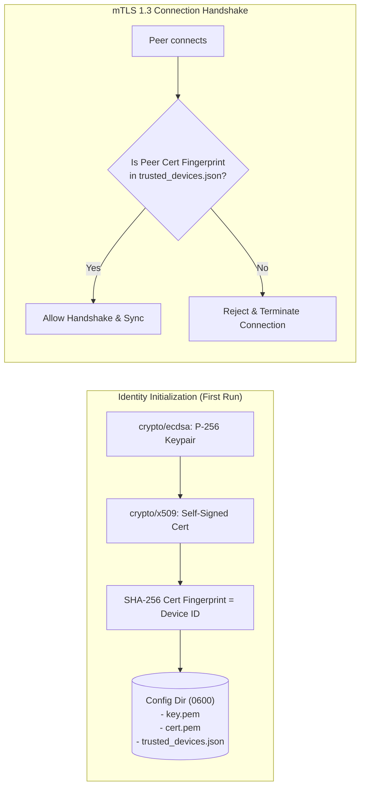
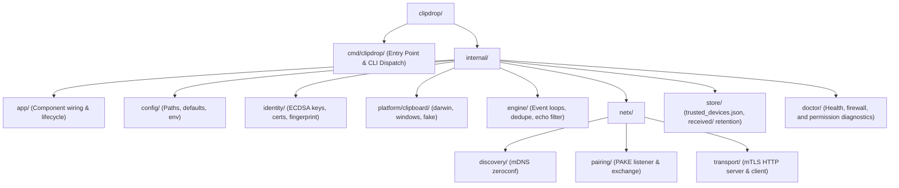

# Clipdrop 

> **Zero-cloud, end-to-end encrypted, peer-to-peer clipboard and screenshot synchronization between macOS and Windows over local Wi-Fi.**

---

### Tech Stack & Core Libraries

  
  
  
  
  
  
  

---

## 🌟 Highlights

- **🔒 Zero Cloud & Zero Telemetry:** Direct P2P transfer over local subnet; no accounts, no relays, no third parties.
- **🛡️ Mutual TLS 1.3 & Pinned Fingerprints:** Custom CA-less trust model. Unpaired peers are dropped at the TLS handshake.
- **🤝 PAKE Out-of-Band Pairing:** 2-minute time-limited pairing code using Password-Authenticated Key Exchange with AES-GCM credential exchange.
- **🔄 Smart Echo Loop Prevention:** Content hashing (SHA-256) and receiver origin tracking guarantee zero ping-pong copy loops.
- **📸 Screenshot-First Design:** Instant PNG validation, size checks, and sub-2-second sync across platforms.

---

## 🏛️ System Architecture

---

## 🤝 Pairing Protocol (PAKE + Credential Exchange)

Before normal synchronization begins, devices establish trust using a temporary pairing listener and Password-Authenticated Key Exchange (PAKE).

---

## ⚡ Sync Protocol & Echo Prevention

The sync engine follows an **Offer / Upload** sequence with strict hash recording to prevent infinite feedback loops.

---

## 🔄 Engine State & Decision Machine

---

## 🔐 Security & Identity Architecture

---

## 🗂️ Project Structure

---

## 💻 CLI Commands & Usage

| Command | Description |
|---|---|
| `clipdrop pair` | **Host side:** Generate a single-use pairing code and open temporary pairing listener (2-min limit). |
| `clipdrop pair join` | **Joiner side:** Input pairing code, discover host over mDNS, and complete PAKE trust exchange. |
| `clipdrop run` | Start the sync daemon in the foreground. Clean exit with `Ctrl+C`. |
| `clipdrop devices` | List all paired and trusted devices with fingerprint and last-seen timestamps. |
| `clipdrop unpair <name>` | Revoke trust for a device and invalidate future mTLS connections. |
| `clipdrop doctor` | Run diagnostics: port availability, permissions, identity files, mDNS multicast, peer pings. |
| `clipdrop version` | Print current build version and protocol specification. |

### Common Flags for `clipdrop run`
- `--images-only` : Disable text clipboard synchronization.
- `--no-text` : Synonym for image-exclusive synchronization.
- `--port <number>` : Custom mTLS listening port (default: `47820`).
- `--peer <ip:port>` : Manual fallback address if mDNS multicast is blocked on the network.
- `--verbose` : Enable detailed `log/slog` debug tracing.

---

## 📄 License

This project is licensed under the [MIT License](file:///Users/rahulls/Projects/Screenshot_Sync/Clipdrop/LICENSE).
